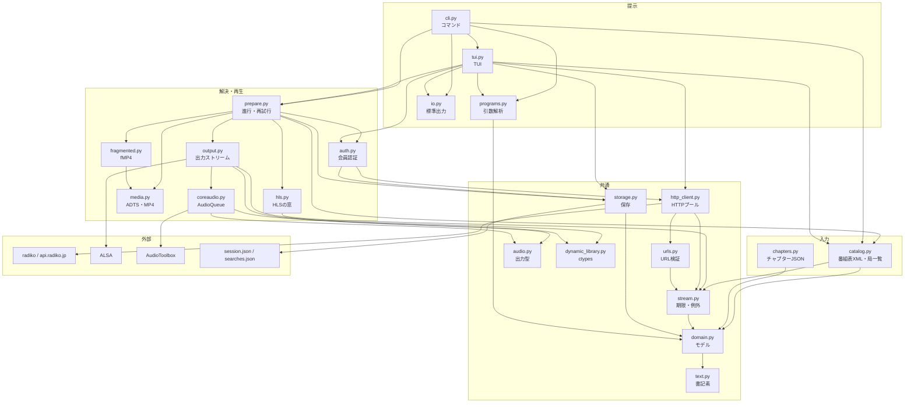

# アーキテクチャ

この文書は `radiko-client-python` のモジュール構成、依存方向、データの流れを説明します。対象は main `40660cd`（2026-11-15）です。Rust 版との機能対応は [parity.md](parity.md) を正とします。

## 全体像

パッケージは2つです。

- `radiko`: 番組表・認証・HLS・復号・出力・保存を扱うライブラリ。端末に依存しません。
- `radiko_client`: CLI と TUI。引数、画面状態、端末入出力を扱います。

依存は `radiko_client` → `radiko` の一方向です。`radiko` は `radiko_client` を import しません。`radiko_client` は `urllib` / `http.client` / `socket` を import せず、通信は `radiko` 側の関数に任せます。

## 層と依存

層は「入力 → 解決・再生 → 提示」の3つです。共通の型・時刻・URL・保存は、どの層からも使います。図は主要な依存だけを示し、すべての import を網羅しません。

## モジュール一覧

| 層 | モジュール | 責務 | 主な入口 |
| --- | --- | --- | --- |
| 入力 | `radiko.catalog` | 番組表 XML・局一覧の解析、日付・地域ごとの取得（最大4並列） | `parse_programs` / `acquire_range` / `CatalogClient` |
| 入力 | `radiko.chapters` | チャプター JSON の解析と時刻検証 | `parse_chapters` / `chapters_from_json` |
| 解決・再生 | `radiko.auth` | 会員ログイン、auth1/auth2、契約フラグの読み取り | `MemberClient` / `authenticate` |
| 解決・再生 | `radiko.prepare` | 番組取得、認証、配信先解決、HLS 再生、再認証・再接続の進行 | `prepare` / `play_station` / `probe` |
| 解決・再生 | `radiko.hls` | メディアプレイリストの解析、窓・通し番号・不連続の管理 | `parse_media_playlist` / `HlsCursor` |
| 解決・再生 | `radiko.media` | ADTS / MP4 の境界検証、PyAV による AAC 復号 | `AdtsDecoder` / `validate_mp4` |
| 解決・再生 | `radiko.fragmented` | fMP4 の初期化・断片解析と復号 | `FragmentedAacDecoder` |
| 解決・再生 | `radiko.output` | 出力ストリームの選択、ALSA とプロセス内 null sink | `open_stream` / `play_samples` |
| 解決・再生 | `radiko.coreaudio` | macOS AudioQueue の出力と既定機器の読み取り | `inspect` / `Stream` / `play` |
| 解決・再生 | `radiko.reauth` | 再生中の HTTP 401 に対する再認証の状態 | `ReauthState` |
| 解決・再生 | `radiko.interactive` | 対話再生のシーク・一時停止・音量の状態 | `InteractiveControl` |
| 解決・再生 | `radiko.timing` | 断片時刻の照合、PCM の切り捨て、再接続の待ち時間 | `ReconnectBudget` / `trim_pcm` |
| 提示 | `radiko_client.cli` | 引数解析、コマンド実行、終了コード、SIGINT | `main` / `run` |
| 提示 | `radiko_client.tui` | 端末の状態機械、描画、ジョブ・認証・再生のスレッド | `Screen` / `run` |
| 提示 | `radiko_client.programs` | CLI と TUI が共有する番組要求・検索条件の解析 | `parse_program_request` / `build_criteria` |
| 提示 | `radiko_client.io` | 標準出力・標準エラーの安全な書き込み | `stdout_ln` / `stderr_ln` |
| 共通 | `radiko.domain` | 番組・局・検索条件・放送日・フィルタの型 | `Program` / `Filter` / `SearchCriteria` |
| 共通 | `radiko.stream` | 配信可否、タイムフリー期限、`ProbeError` | `eligible` / `availability` |
| 共通 | `radiko.urls` | 信頼ドメイン、ループバック、クエリ付与 | `trusted` / `transport_url` |
| 共通 | `radiko.text` | 書記素、表示幅、制御文字の処理 | `graphemes` / `display_width` |
| 共通 | `radiko.http_client` | Keep-Alive 接続プール、再試行、番組表・音声の取得 | `catalog_fetch` / `stream_get` |
| 共通 | `radiko.storage` | `session.json` / `searches.json`、原子的置換、0700 / 0600 | `SessionStore` / `SearchStore` |
| 共通 | `radiko.audio` | 出力の型と例外 | `OutputInfo` / `OutputCapability` / `OutputSummary` |
| 共通 | `radiko.dynamic_library` | ctypes のライブラリ解決と読み込みのキャッシュ | `find_library` / `open_library` |
| 共通 | `radiko.fixtures` | 試験専用の合成 MP4 / ADTS。本番経路から import しない | `synthetic_fragment` / `encode_adts_sine` |

`__init__.py`（`radiko` / `radiko_client`）と `__main__.py` は省略しています。

設計判断は [ADR 0001](adr/0001-use-pyav.md) / [ADR 0002](adr/0002-in-process-null-sink.md) / [ADR 0003](adr/0003-macos-audioqueue.md) に記録しています。

## データの流れ

1. 番組表: `catalog.parse_programs` が番組表 XML を `ProgramList`（`Program` の集合）へ変換します。`catalog.acquire_range` は地域・日付ごとに取得し、最大4並列で集めます。
2. 準備: `prepare.prepare` が `fetch_program` で番組を確定し、`auth.authenticate` で auth1/auth2 を実行します。配信先 XML を `catalog.parse_endpoints` で読み、`_playlist_url` で HLS の URL を作ります。
3. HLS: `hls.parse_media_playlist` がセグメント一覧を `MediaPlaylist` にします。`HlsCursor` が通し番号で次に取るセグメントを決め、`segment_schedule` が番組時刻を1パスで求めます。
4. 取得と復号: `http_client.stream_get` がセグメントを取得します。ADTS は `media.AdtsDecoder`、fMP4 は `fragmented.FragmentedAacDecoder` が PCM にします。
5. 出力: `output.open_stream` が OS に応じて ALSA / AudioQueue / null sink のストリームを返します。`play_samples` が音量とチャンネルを合わせて書き込みます。
6. 提示: CLI は `PlayReport` / `ProbeReport` を表示に使います。TUI は `Screen` の状態として描画します。

TUI の描画は状態を読むだけで、通信と復号を呼びません。通信は `_fetch_programs` などが `radiko.catalog` / `radiko.http_client` / `radiko.auth` / `radiko.prepare` の関数を呼び、復号と出力は `prepare.play_station` の再生ジョブが担います。`tui.py` は HTTP クライアントを実装しません。

## 新しい機能の置き場所

| 追加するもの | 置く場所 |
| --- | --- |
| 番組表・チャプターの新しい項目や形式 | `catalog` / `chapters` と `domain` の型 |
| 新しい配信プロトコル・セグメント形式 | `hls` / `media` / `fragmented` |
| 新しい音声出力先 | `output` の `OutputStream` を実装し、OS 分岐を `host_backend` に足す |
| 再認証・再接続の規則 | `reauth` / `timing` / `prepare` |
| 新しい CLI サブコマンド | `cli` と `programs`。通信は `radiko` 側の関数へ置く |
| 新しい画面・キー | `tui` の `Screen` と `handle`。HTTP を直接書かない |
| 共有の型・時刻・URL・文字幅 | `domain` / `stream` / `urls` / `text` |
| 試験専用の合成データ | `fixtures`。本番モジュールに置かない |

## 規模（実測）

- BRIEF の基準値: ソース 27ファイル / 10,075行、テスト関数 229。
- main `40660cd`: ソース 28ファイル / 10,337行、テスト関数 236（`def test_` の数）。P2 までの変更で `dynamic_library.py` が加わり、テスト関数も増えました。
- 実行件数はパラメータ化を含むため、macOS で 254 passed + 3 skipped です。Linux CI の結果を最終根拠にします。
